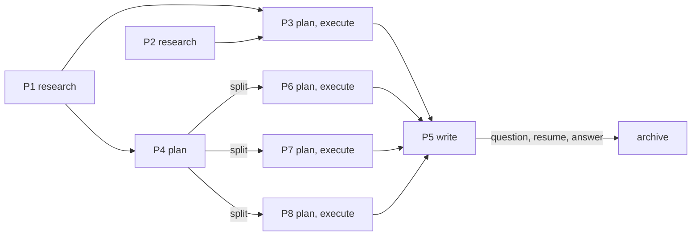

# claude-supervisor

claude-supervisor is an independent project. It is not affiliated with or endorsed by Anthropic.

A supervisor-based agent pack for [Claude Code](https://code.claude.com/docs). One supervisor routes every request either to the full harness (leads that fan out to parallel workers, with a critic and a scope-critic loop) or to fast Haiku specialists for small tasks.

The details are in [docs/architecture.md](docs/architecture.md).

## Install

Requirements:
- Claude Code 2.1.293 or newer, logged in
- `python3` 3.9 or newer, on macOS or Linux

```bash
git clone https://github.com/sly2j/claude-supervisor.git ~/Work/claude-supervisor
cd ~/Work/claude-supervisor
./deploy doctor      # preflight check
./deploy install     # installs into ~/.config/claude-supervisor
```

Then run `claude-supervisor` and log in once. It runs as the supervisor; type `/agents` to see the pack. `--global` installs into `~/.claude` instead; `--tag <t>` makes another sandbox, `claude-<t>`.

Or let Claude do it: run `claude` inside the clone and say *"deploy this pack"*. It follows [docs/deploy.md](docs/deploy.md).

**Update:** `git pull && ./deploy install`. Files you edited in the install dir are kept, and the script lists them.
**Check:** `./deploy status`. **Remove:** `./deploy uninstall --yes`.
**Token provider:** add `--base-url URL --token-file PATH` to a sandbox install ([docs/deploy.md](docs/deploy.md#token-provider)).
**Version:** `VERSION` holds the pack version (`1.x`, bumped in every commit on main). `./deploy status` shows the installed version next to the checkout's and marks a `MISMATCH`.

Recommended: Anthropic's document skills for docx, pdf, pptx, and xlsx work. In Claude Code, run `/plugin marketplace add anthropics/skills` and install `document-skills`.

## How It Works

**Mode 1, the full harness.** The supervisor dispatches a lead. The lead writes a contract, then dispatches N parallel workers. `critic` reviews the result for quality and compliance. `scope-critic` then reviews the critic's findings and the artifact for bloat and scope creep. The lead decides what to fix, and the loop repeats for up to 3 rounds.

**Mode 2, the quick tier.** Few-line edits, commits, and lookups go straight to a Haiku specialist. It escalates with `ESCALATE:` if the task is bigger than it looked.

The supervisor chooses the mode. To choose it yourself, say "quick" or "full".

## Work Packages

Work too large for one plan is broken into packages. Each package is a small project of its own, with only the stages it needs: `research`, `plan`, `execute`, `write`. Packages depend only on the packages whose output they consume, so independent ones run in parallel. The planner writes them as a `## Work Packages` section of the plan; you can ask for packages or a flat plan explicitly.

The supervisor runs the packages in waves: every package whose dependencies are done gets its next stage dispatched to that stage's lead, all at once. After each wave one `quick-edit` call records the new status lines, and you see a table of every package plus the questions the leads raised. The plan file is the only state, so a new session resumes from it. A package that needs its own breakdown is split into new packages in the parent plan, so plans never nest and agent depth never grows; when every package is done, the plan, its child plans, and its research move to `docs/archive/`.

A package block (field rules in `pack/agents/planner.md`):

```
### P2: deploy hook
- Goal: deploy installs the hook; done when `./deploy doctor` reports it
- Owns: `deploy`, tests/test_deploy.py
- Deps: P1
- Stages: plan, execute
- Status: plan
- Artifacts: docs/plan-hooks-p2.md
```

Three shapes of work.

A single fix needs no packages: one lead, one report, no plan to archive.


A chain, where each package consumes the one before it: six waves, one package each, a table after every wave, then the archive move.


A graph: wave 1 runs P1 and P2 together. P4's plan stage returns `Amend parent:`, which splits it into P6, P7 and P8, each with its own plan. P5 asks you a question and blocks; the session ends; a new session asks `scout` for the state, you answer, and P5 runs.



## Agents

| Agent | Role | Model / effort |
|---|---|---|
| `supervisor` | Main thread: routing, briefing, synthesis | fable / high |
| `researcher` | Lead: research artifacts in `docs/research-*.md` | opus / high |
| `planner` | Lead: implementation plans in `docs/plan-*.md` | fable / xhigh |
| `executor` | Lead: code, tests, config, agent definitions, conflicts, Python environments | opus / high |
| `writer` | Lead: scientific and technical prose, slide content, project docs | opus / high |
| `researcher-worker` | Worker: one bounded investigation | sonnet / high |
| `planner-worker` | Worker: one bounded repo question for a plan | sonnet / high |
| `executor-worker` | Worker: one unit of change in its assigned files | sonnet / high |
| `writer-worker` | Worker: extracts sources, drafts and revises prose | opus / high |
| `critic` | Reviewer: quality and compliance, PASS/REVISE | opus / xhigh (fable when called by planner) |
| `scope-critic` | Reviewer: KEEP/DOWNGRADE/DROP rulings and CUT list | fable / high |
| `quick-edit` | Quick: small, exact edits | haiku / xhigh |
| `git-ops` | Quick: routine git with guardrails | haiku / xhigh |
| `scout` | Quick: read-only lookups | haiku / xhigh |

Rows marked `fable`, and the `model: fable` dispatch overrides, deploy on Opus unless the pack is installed with `--fable`. See [docs/deploy.md](docs/deploy.md).

## Skills

| Skill | Purpose |
|---|---|
| `lead-loop` | The Mode 1 protocol, preloaded by every lead |
| `git-safety` | Git guardrails, commit rules, conflict-resolution procedure |
| `python-env` | Creating, repairing, and validating conda, uv, or venv environments |
| `agent-authoring` | Conventions for this pack's agents and skills |
| `writing-rules-persistence` | Per-project `docs/writing-rules.md` schema and precedence |
| `science-writing-style` | Scientific prose style, AI-tell avoidance, prose review criteria |
| `presentation-style` | Slide content style |
| `document-extraction`, `email-extraction` | Structured extraction from source documents and email threads |
| `meeting-summary` | Meeting transcript to minutes (`/meeting-summary <file>`) |
| `project-backup` | Timestamped, verified zip backups with retention |

## Using It

Just ask for what you want. The supervisor picks the mode, but you can steer it:

| You say | What happens |
|---|---|
| "fix the typo in README line 12", "commit this" | Mode 2: one Haiku specialist, done in seconds |
| "research how X works", "plan Y", "implement the plan", "draft the proposal intro" | Mode 1: a lead, parallel workers, then critic and scope-critic |
| "quick: ..." or "just do it" | Forces Mode 2 |
| "full: ..." or "with review" | Forces Mode 1 |
| "review this diff/plan/draft" | critic, then scope-critic, with no edits |
| "use the strongest drafter" | writer runs writer-worker on Fable |

Larger work flows `researcher` -> `planner` -> your approval -> `executor`. Artifacts land in `docs/research-*.md` and `docs/plan-*.md`, so you can read and annotate them between steps.

Not every session needs the supervisor: plain `claude` starts plain Claude Code, and `claude-supervisor` starts the supervisor.

## Troubleshooting

| Symptom | Fix |
|---|---|
| Agents don't show in `/agents` | Start a new `claude-supervisor` session. Run `./deploy status` |
| Leads do the work themselves instead of fanning out | Run `./deploy doctor`. `CLAUDE_CODE_MAX_SUBAGENT_SPAWN_DEPTH` may be below 2 |
| Every agent runs on the same model | `CLAUDE_CODE_SUBAGENT_MODEL_FORCE` is set. `doctor` reports it |
| `install` reports "kept local modification" | Expected: your edit in the install dir wins. Use `--overwrite-local` to take the pack version (the old file is backed up) |
| `install` refuses an "unmanaged" file | A file with that name already exists in the install dir. Rename yours, or use `--overwrite-local` |
| Claude Code asks to bill Fable to usage credits | You installed with `--fable`; run `./deploy install` without it. `./deploy status` prints the current choice |
| Your own `agent` setting wasn't replaced | Expected. Use `--force-default-agent` to switch to the supervisor |

## Repository Layout

```
pack/agents/        agent definitions (deployed to <install dir>/agents)
pack/skills/        skills (deployed to <install dir>/skills)
deploy              installer: install | status | uninstall | doctor
tests/              deploy behavior tests + pack lint
docs/               research, architecture, deploy runbook
docs/archive/       finished plans, their child plans and research
VERSION             pack version (1.x, bumped in every commit on main)
```

Run `python3 -m pytest -q` before deploying changes to the pack.
