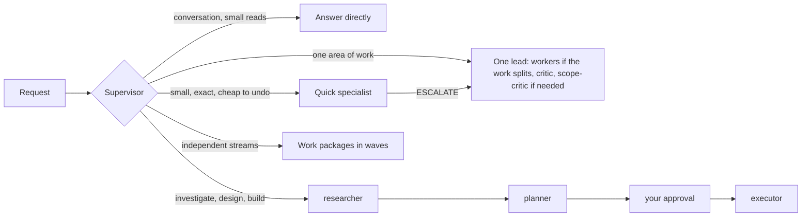
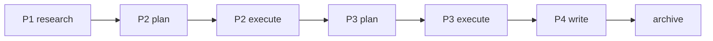
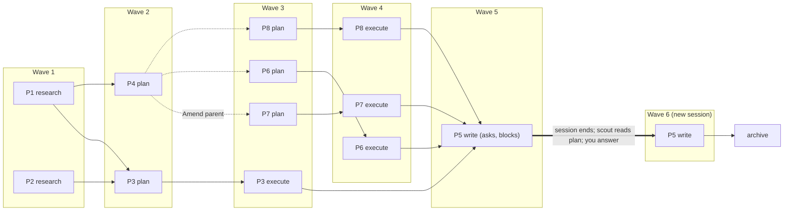

# Supervisor for Claude

Supervisor for Claude is a multi-agent orchestration layer for [Claude Code](https://code.claude.com/docs). It is centered around a single supervisor agent that dispatches tasks based on scope and complexity. The supervisor answers simple questions itself, sends small exact tasks to a fast, cheap agent, and gives larger work to a lead agent. The lead splits the work across parallel workers when it has several independent parts, otherwise does it itself, and has critic agents review the result for quality and scope.

*Supervisor for Claude is an independent project, not affiliated with or endorsed by Anthropic.*

## What It's For

Supervisor for Claude is built for long-horizon software and scientific-research tasks: complex, multi-session work that benefits from a research-plan-execute loop and persistent short- and long-term memory. For smaller one-off tasks, plain `claude` is likely more effective.

- **Parallel work:** a plan splits large jobs into independent pieces (work packages) that run side by side (waves).
- **Project memory:** `.supervisor/` holds committed memory designed after project-management practice: long-term goals, a mid-term roadmap, and short-term plans, plus a decision log, facts, conventions, and approved lessons learned. Plan files hold state, so work resumes in a new session. See [Persistence And Memory](#persistence-and-memory).

## Quick Start

Requirements:
- Claude Code 2.1.293 or newer, logged in
- `python3` 3.9 or newer, on macOS or Linux
- `git`, to clone and for `update`

```bash
git clone https://github.com/sly2j/claude-supervisor.git ~/Work/claude-supervisor
cd ~/Work/claude-supervisor
./deploy install     # profile in ~/.config/claude-supervisor, launcher in ~/.local/bin
claude-supervisor    # log in once; type /agents to see the pack
```

`install` prints a WARNING if `~/.local/bin` is not on your `PATH`. To add it, run this, then open a new terminal (use `~/.bashrc` for bash):

```bash
echo 'export PATH="$HOME/.local/bin:$PATH"' >> ~/.zshrc
```

For other options, see [Choosing An Install](#choosing-an-install).

Notes:
- If `install` prints ERROR, see [Troubleshooting](#troubleshooting).
- To let Claude install it instead, run `claude` inside the clone and say *"deploy this pack"*; it follows [docs/deploy.md](docs/deploy.md).

## Using It

The pack is one supervisor, four leads for larger work, their workers, two reviewers, and a few quick specialists. Who handles what:
- `supervisor`: your session; routes requests, briefs agents, and reports back
- `researcher`: investigation, code tracing, literature; writes `.supervisor/working/research/research-*.md`
- `planner`: decision-and-outline plans, questions first, in `.supervisor/working/plans/plan-*.md`
- `executor`: code, tests, config, agent definitions, git conflicts, Python environments; works in a worktree and lands its change sets locally
- `writer`: scientific and technical prose, slide content, project docs
- `researcher-worker`, `planner-worker`, `executor-worker`, `writer-worker`: the parallel workers a lead dispatches; you never call them yourself
- `critic`, `scope-critic`: review a lead's result, for quality and, when needed, for scope creep
- `fixer`: small, exact edits; runs a given command; tears down recorded test residue
- `curator`: closes out finished plans into memory and the archive; handles "remember X" / "forget X" / "make this a project"
- `git-ops`: routine git with guardrails
- `scout`: read-only lookups

Just ask for what you want. The supervisor picks the path:

| Situation | Path | Why |
|---|---|---|
| Conversation, general advice, one or two small reads | The supervisor answers directly | Nothing to delegate |
| Fully specified, small, local, no design decision, cheap to undo | One quick specialist: `fixer`, `git-ops`, or `scout` | Cheapest path, no review loop |
| Specified and local, but it needs a design call or is not cheap to undo | One lead and one review round | Too much for a quick specialist, less than the full loop |
| Anything else in one area of work | One lead (`researcher`, `planner`, `executor`, or `writer`) with workers when the work splits, and review | Design judgment gets reviewed |
| Investigation, then design, then code | `researcher` -> `planner` -> your approval -> `executor` | You approve the plan before code is written |
| Streams that each need their own research, plan, or write stage | Work packages, run in waves | Independent streams run in parallel |
| "review this diff/plan/draft" | Reviewers only, no edits | You asked for a review |
| A quick specialist finds the task bigger than it looked | Re-routed to one lead, with the specialist's findings | The quick tier no longer fits |

To choose yourself, say "quick" or "just do it" for a quick specialist, or "full", "thorough", or "with review" for a lead.

Skills you run yourself:
- `/meeting-summary <transcript> [notes]`: minutes from a meeting transcript
- `/project-backup`: timestamped, verified zip backup with retention
- `document-extraction`, `email-extraction`: the substance of a document or email thread, as notes to write from
- `/supervisor-config critic codex|claude|status`: switch the critic between Codex and Claude from inside a session (see [Optional: Codex As Critic](#optional-codex-as-critic))

The full inventory, with models, effort, workers, reviewers, and internal skills, is in [docs/architecture.md](docs/architecture.md#agents).

## How It Works

**The full loop** (Mode 1 in [docs/architecture.md](docs/architecture.md#mode-1-the-full-loop)). The supervisor hands the task to a lead. The lead states the goal and acceptance criteria, splits the work across parallel agents when it has several independent parts, otherwise does it itself, and has the result reviewed: `critic` checks quality, and when critic finds more than nits or the result is large, `scope-critic` checks the result and the review for bloat and scope creep. The lead fixes what matters and the loop runs up to three times (once for plans, since you review the plan next). A `REVIEW.md` at your repo root adds your own review rules.

**The quick tier** (Mode 2). Small edits, routine git, and read-only lookups go to a fast, cheap specialist with no review. If the task turns out bigger than it looked, the specialist hands it back and the supervisor re-routes it to a lead.



**Why this design.** Long contexts fail in known ways: a bad fact gets repeated, the model leans on its history over its training, extra tools and stale facts crowd out the task. These failures get worse as context accumulates over a long task or a long project history. Supervisor for Claude is built to counter these failures. Context quarantine and offloading are central to the design: the supervisor reads almost nothing, every lead and worker gets a fresh window and returns a capped report, and plans and research live in files. See [docs/context-engineering.md](docs/context-engineering.md) for the design rationale.

## Larger Work

Larger work runs as a chain: `researcher` -> `planner` -> your approval -> `executor`. The supervisor skips any stage that adds nothing; a bug with an obvious fix goes straight to `executor`. Plans and research land in your project's `.supervisor/working/` (`plans/plan-*.md`, `research/research-*.md`), so you can read and annotate them between steps; finished ones move to `.supervisor/archive/working/`.

A plan splits a large job into work packages when its streams each need their own research, plan, or write stage; plain parallel work stays a flat plan. Each package lists only the stages it needs and depends only on the packages whose output it consumes.

The supervisor runs packages in waves. Each wave runs, all at once, the next stage of every unblocked package whose dependencies are done. After each wave you see a status table of every package and the questions the leads raised. A question blocks its package until you answer, in this session or a later one; the plan file holds the state and a log of what ran and what is still open.

A chain, where each package consumes the one before it: six stages, six waves.



A graph: P4's plan splits it into P6, P7, and P8; P5 asks a question in wave 5 and blocks; in a new session you answer, and wave 6 re-runs P5.



The mechanics (package fields, `Amend parent:`, the log, the archive move) are in [docs/architecture.md](docs/architecture.md#mode-1-the-full-loop).

## Persistence And Memory

Supervisor for Claude keeps a per-project memory store in `.supervisor/`, committed with the repo. Agents read it when they start work and keep it current as they go, so decisions, facts, conventions and lessons survive across sessions, show up in `git log`, can be reviewed in a pull request, and reach your collaborators. On a project that runs for weeks, this keeps last week's decisions and a researcher's findings from being lost or rediscovered.

This is separate from Claude Code's own memory. Your user `CLAUDE.md` and auto memory hold personal preferences; auto memory is per repository but lives on your machine, so collaborators never see it. `.supervisor/` holds what the project itself needs to remember.

The memory model:

- **Layout:** long-term memory is `memory/<kind>/`, one file per entry, with `history.md` listing what landed; short-term memory is `working/`, which holds research, plans and per-document writer state; `archive/` mirrors both; `.supervisor/README.md` explains the layout.
- **Entry kinds:** decisions, facts, goals, conventions, and lessons. A lesson is recorded only after you approve it.
- **Goal horizons:** long-term goals in `memory/goals/`, a mid-term `roadmap.md`, and short-term plans and research in `working/`.
- **Superseding:** a changed decision gets a new entry and the old one moves to `archive/`.
- **How agents use it:** A lead agent retrieves relevant memories when it starts. The `fixer` agent logs user-provided information into the short-term memory (a plan's `## Log`). The `curator` agent turns short-term memory into long-term memory entries.
- **`curator`:** The `curator` agent maintains the memory store by archiving short-term memories, keeping roadmaps up to date, flagging stale short-term memories, and curating the long-term memory store.
- **Your controls:** You can tell supervisor to "remember X", to "forget X", or to "make this a project".
- **Where it applies:** Memories are only stored when supervisor considers the working folder part of a project. A project is auto-detected when the folder is inside a git repository, or when it, or a folder above it, holds `.supervisor/`, `.claude/`, `CLAUDE.md` or `AGENTS.md`, or when you tell supervisor to make the folder a project. Your home directory never counts, either way.
- **Committed by default:** `.supervisor/` is committed with the rest of your repo, so the memory is part of the repo history, shows up in pull requests, and reaches collaborators and other checkouts; a worktree's store belongs to its branch and lands with it. Add `.supervisor/` to `.gitignore` and the store stays local: it works only on your machine and collaborators do not see it.

## Branches, Worktrees And Versions

In a git repo, `executor` works on its own branch in a worktree under `<repo>/.claude/worktrees/` and, when the checks pass, lands it locally as one squash commit. Nothing is pushed, except when a session is confined to its worktree, and then only after it asks you. Quick edits, conflict resolution, environment repair, and repos with submodules work in the current checkout, as does anything you ask to run "in place". No version is created or bumped unless your repo opts in; a repo with no versioning is asked once, and the answer is recorded in `CLAUDE.md`. A sentence in your repo's `CLAUDE.md` overrides any of these; there is no config file. Branch naming, the ignore rule for the worktree path, environment files, leftover worktrees, and force-push grants are in [docs/architecture.md](docs/architecture.md#git-work).

Outside a project (see [Persistence And Memory](#persistence-and-memory)) nothing is persisted: no worktree, no version, no question.

## Choosing An Install

| Install | Where | Start it with |
|---|---|---|
| `./deploy install` | Profile in `~/.config/claude-supervisor` | `claude-supervisor` |
| `./deploy install --tag <t>` | Another profile, `~/.config/claude-<t>` | `claude-<t>` |
| `./deploy install --global` | `~/.claude`, no launcher (not recommended) | plain `claude` |

- Supervisor for Claude installs by default into a profile: a private Claude Code config dir (`~/.config/claude-<tag>`) with its own launcher, login, settings, and history, separate from your default `claude` environment. `claude-supervisor` starts Supervisor for Claude and plain `claude` stays plain Claude Code, so switching is a matter of which command you start.
- A profile's first install copies your settings, `CLAUDE.md`, commands, and your own agents and skills from `~/.claude`; logins, history, plugins, MCP servers, and `~/.claude.json` state stay behind.
- With `--global` (not recommended), plain `claude` becomes the supervisor.
- `--prefix <dir>` (default `~/.local`) puts the launcher in `<dir>/bin` and the update registry under `<dir>/state`.

Four agents (`supervisor`, `planner`, `writer`, `scope-critic`) are written for a top-tier frontier model (e.g. Fable; see [Models And Cost](docs/architecture.md#models-and-cost)). By default they run on Fable if you have access. To use Opus instead, add `--fable-is-opus` to the `claude-supervisor` call (not for global installs, which have no launcher). To use another model, set `ANTHROPIC_DEFAULT_FABLE_MODEL` in your environment before starting the supervisor. See [docs/deploy.md](docs/deploy.md#fable-or-opus).

## Optional: Codex As Critic

Every agent in the pack runs on Claude, including the `critic` that reviews a lead's result. You can run that one agent on OpenAI's Codex CLI instead, so the work and its review come from different model families with different blind spots. Only the critic changes: `scope-critic`, the leads and the workers stay on Claude.

It is off by default, and turning it on has a cost: Codex reviews spend your OpenAI/ChatGPT quota, and each review sends the repository content under the current directory, the review brief and the diff to OpenAI. You need the `codex` CLI on `PATH`, logged in (`codex login`). `enable` checks both, prints that consent text and asks for a yes; if `codex` is already on your `PATH`, `install` ends with a one-line hint naming the enable command.

```bash
claude-supervisor critic enable            # asks once; `enable gpt-6-astra` picks another model
claude-supervisor critic status            # backend, model, Codex login, permission rule
claude-supervisor critic disable
./deploy critic enable --global            # a --global install has no launcher; --tag <t> for another profile
```

From inside a session, `/supervisor-config critic codex [model]` enables, `/supervisor-config critic claude` disables and `/supervisor-config critic status` reports. It asks the same consent question, and each of these costs one permission prompt by design, so no agent can turn Codex on unasked. A switch takes effect from the next task, with no reinstall. The default model is `gpt-6.1-sol` at effort `high`.

When Codex is enabled but cannot review (not on `PATH`, not logged in, a timeout after 540 s, an error, or an unusable response), that round falls back to the Claude `critic` automatically, and the lead's report names which engine reviewed each round. `critic status` and `./deploy doctor` show the login state. The permission rule `install` writes, per-domain model overrides and the caveats (network access from the sandbox, model IDs, symlinked install paths, review time) are in [Codex As Critic](docs/deploy.md#codex-as-critic).

## Documentation

- [docs/deploy.md](docs/deploy.md): Detailed installation instructions. In most cases the "Quick Start" instructions should be sufficient.
- [docs/architecture.md](docs/architecture.md): Overview of the workflow architecture and every agent and skill.
- [docs/context-engineering.md](docs/context-engineering.md): Context engineering considerations to allow for long-horizon tasks.

## Maintaining An Install

Day to day, the launcher is all you need:

```bash
claude-supervisor update          # claude update, then this profile's pack; --all updates every install
claude-supervisor status          # installed version and per-file state
claude-supervisor list            # every registered install: version, branch, commit, launcher
claude-supervisor --version       # pack and claude versions; -h lists the launcher's commands
claude-supervisor uninstall       # delete this profile: its dir with sessions, history, login, and token, plus its launcher
```

`update` asks once (`--yes` skips, `--dry-run` shows what would change) and takes only what is pushed to the install's branch (`main` for a normal clone), so local checkout edits are ignored; files you edited in the install dir are kept. `uninstall` asks you to type the tag; run it with `--dry-run` first. Each profile is installed under a tag, and `supervisor` is the default. A profile installed with `--tag foo` has the launcher `claude-foo`, which takes the same commands.

A launcher acts on its own profile unless you say `--all`. The `./deploy` script is the tool that created the launchers, and it can act on any install. Use it for the first install, for `doctor` (`claude-supervisor doctor` is Claude Code's own doctor, not this one), for a `--global` install, which has no launcher, for removing every install at once, and for `migrate`. Run it from your checkout:

```bash
./deploy install                  # deploy the checkout as it is, local edits included
./deploy doctor                   # PASS/WARN/FAIL checks on the environment and the install
./deploy update --all             # every registered install; --tag <t> or --global for one
./deploy uninstall --dry-run      # then --yes; --global removes only the pack's files
./deploy migrate                  # move a pack installed in ~/.claude to the default profile
```

`install`, `doctor`, `status`, `update`, and `uninstall` take `--tag <t>`, `--target <dir>`, or `--global` to pick the install (the default profile when none is given). The full reference (`--from`, `--force`, `--source`, the registry and tool copy each install keeps) is in [docs/deploy.md](docs/deploy.md).

Major changes per version are in [CHANGELOG.md](CHANGELOG.md).

To route a profile through a token provider (only for a proxy or gateway), see [docs/deploy.md](docs/deploy.md#token-provider).

## Migrating From Older Versions

Run `./deploy migrate` from the checkout and confirm once. It removes the old pack from `~/.claude` (backing up files you edited and restoring your `agent` setting), installs and registers the default profile with its `claude-supervisor` launcher, and checks that `~/.local/bin` is on `PATH`. See [docs/deploy.md](docs/deploy.md#migrate).

## Troubleshooting

| Symptom | Fix |
|---|---|
| `claude-supervisor: command not found` | Add `~/.local/bin` (or `<prefix>/bin` for a `--prefix` install) to `PATH` |
| Agents don't show in `/agents` | Start a new `claude-supervisor` (or `claude-<tag>`) session. Run `./deploy status` |
| One agent does several independent parts itself instead of delegating | Run `./deploy doctor`. `CLAUDE_CODE_MAX_SUBAGENT_SPAWN_DEPTH` may be below 2 |
| Every agent runs on the same model | `CLAUDE_CODE_SUBAGENT_MODEL_FORCE` is set. `doctor` reports it |
| `install` reports "locally modified; kept" | Expected: your edit in the install dir wins. Use `--overwrite-local` to take the pack version (the old file is backed up) |
| `exists but is not managed by this pack` (`install` or `update`) | A file with that name, such as your own agent or skill seeded from `~/.claude`, shadows a pack name. Rename yours, or run `./deploy install --overwrite-local` from your checkout to replace it; `update` never does |
| `STALE <key>: ... branch <b> is gone` (`update` exits 3) | The install's branch no longer exists on its remote. Remove the install with the command the message prints, then install from a checkout of a live branch |
| `was installed with --prefix X` | Pass `--prefix X` |
| `exists and is not a claude-supervisor launcher` | Move that file aside, or choose another `--tag` or `--prefix` |
| `another deploy is running` | Wait for it to finish, then re-run |
| `is not registered under prefix X` | Run `./deploy install` once (pass `--prefix` if you installed with one) |
| `cannot read branch` | Check network access and credentials |
| Claude Code asks to bill Fable separately | Fable is the default. Launch with `--fable-is-opus`, or set `ANTHROPIC_DEFAULT_FABLE_MODEL=claude-opus-5-5` in your shell profile or `settings.json` (see [docs/deploy.md](docs/deploy.md#fable-or-opus)) |
| Your own `agent` setting wasn't replaced | Expected. Use `--force-default-agent` to switch to the supervisor |

## Repository Layout

```
pack/agents/        agent definitions (deployed to <install dir>/agents)
pack/skills/        skills (deployed to <install dir>/skills)
deploy              installer: install | update | status | list | uninstall | doctor | migrate | critic
tests/              deploy tests, pack lint, VERSION check
docs/               architecture.md, context-engineering.md, deploy.md (deploy runbook)
CLAUDE.md           instructions for Claude working in this repo
REVIEW.md           review rules for this repo
.supervisor/        project memory; roadmap.md holds open work items
VERSION             pack version
CHANGELOG.md        major changes per version
LICENSE             Apache License 2.0
```

To edit the pack, follow [CLAUDE.md](CLAUDE.md).

## License

Licensed under the Apache License, Version 2.0. See [LICENSE](LICENSE).
