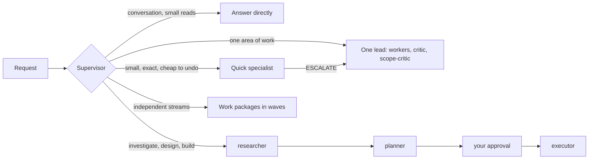
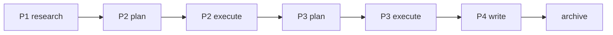
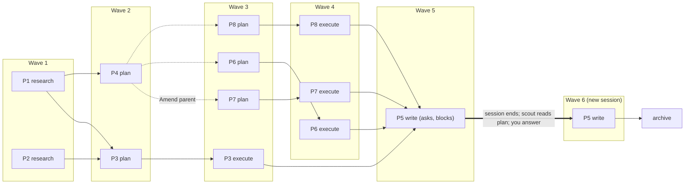

# Supervisor for Claude

Supervisor for Claude is a workflow pack that provides multi-agent task orchestration for [Claude Code](https://code.claude.com/docs). It is centered around a single supervisor agent that dynamically dispatches tasks based on scope and complexity. The supervisor answers simple questions itself, sends small exact tasks to a fast, cheap agent, and gives larger work to multi-agent worker teams. These teams execute the work in parallel where possible and iterate with critic agents that review it for quality and scope.

*Supervisor for Claude is an independent project, not affiliated with or endorsed by Anthropic.*

## What It's For

Supervisor for Claude is built for long-horizon software and scientific-research tasks: complex, multi-session work that benefits from a research-plan-execute loop and persistent short- and long-term memory. For smaller one-off tasks, plain `claude` is likely more effective.

Supervisor for Claude installs by default as a sandbox separate from your default `claude` environment, which keeps the two apart. `claude-supervisor` starts Supervisor for Claude and plain `claude` stays plain Claude Code, so switching is a matter of which command you start. Supervisor for Claude supports multiple independent sandboxes, and a global install into `~/.claude` if you really want to.

- **Parallel work:** during planning, complex work is split into work packages that run in parallel waves.
- **Project memory:** `.supervisor/` holds committed memory designed after project-management practice: long-term goals, a mid-term roadmap, and short-term plans, plus a decision log, facts, conventions, and approved lessons learned. Plan files hold state, so work resumes in a new session. See [Larger Work](#larger-work).

## Quick Start

Requirements:
- Claude Code 2.1.293 or newer, logged in
- `python3` 3.9 or newer, on macOS or Linux
- `git`, to clone and for `update`

```bash
git clone https://github.com/sly2j/claude-supervisor.git ~/Work/claude-supervisor
cd ~/Work/claude-supervisor
./deploy install     # sandbox in ~/.config/claude-supervisor, launcher in ~/.local/bin
claude-supervisor    # log in once; type /agents to see the pack
```

`install` prints a WARNING if `~/.local/bin` is not on your `PATH`. To add it, run this, then open a new terminal (use `~/.bashrc` for bash):

```bash
echo 'export PATH="$HOME/.local/bin:$PATH"' >> ~/.zshrc
```

To skip the sandbox, run `./deploy install --global` instead: it installs into `~/.claude` with no launcher, and plain `claude` becomes the supervisor. For other options, see [Choosing An Install](#choosing-an-install).

A sandbox is a private config dir, not a security sandbox. If `install` prints ERROR, see [Troubleshooting](#troubleshooting).

Or let Claude do it: run `claude` inside the clone and say *"deploy this pack"*. It follows [docs/deploy.md](docs/deploy.md).

Recommended: Anthropic's document skills for docx, pdf, pptx, and xlsx work. Inside a claude-supervisor session, run `/plugin marketplace add anthropics/skills` and install `document-skills`.

## Choosing An Install

| Install | Where | Start it with |
|---|---|---|
| `./deploy install` | Sandbox in `~/.config/claude-supervisor` | `claude-supervisor` |
| `./deploy install --tag <t>` | Another sandbox, `~/.config/claude-<t>` | `claude-<t>` |
| `./deploy install --global` | `~/.claude`, no launcher | plain `claude` |

A sandbox has its own login, settings, and history, and plain `claude` stays plain Claude Code. Its first install copies your settings, `CLAUDE.md`, commands, and your own agents and skills from `~/.claude`; logins, history, and plugins stay behind, and so do MCP servers and `~/.claude.json` state. With `--global`, plain `claude` becomes the supervisor. `--prefix <dir>` (default `~/.local`) puts the launcher in `<dir>/bin` and the update registry under `<dir>/state`. `doctor`, `status`, `update`, and `uninstall` take the same `--tag` or `--global` (and `--prefix`) as the install.

Three agents (`supervisor`, `planner`, `scope-critic`) are written for the top model tier, Fable-level: the strongest and costliest (see [Models And Cost](docs/architecture.md#models-and-cost)). Fable can be billed separately. These agents run on Fable unless `ANTHROPIC_DEFAULT_FABLE_MODEL` is set in your environment, which the launcher respects; `claude-supervisor --fable-is-opus` runs that session on Opus. See [docs/deploy.md](docs/deploy.md#fable-or-opus).

## Using It

Just ask for what you want. The supervisor picks the path:

| Situation | Path | Why |
|---|---|---|
| Conversation, general advice, one or two small reads | The supervisor answers directly | Nothing to delegate |
| Fully specified, small, local, no design decision, cheap to undo | One quick specialist: `clerk`, `git-ops`, or `scout` | Cheapest path, no review loop |
| Anything else in one area of work | One lead (`researcher`, `planner`, `executor`, or `writer`) with workers and review | Design judgment gets reviewed |
| Investigation, then design, then code | `researcher` -> `planner` -> your approval -> `executor`, skipping stages that add nothing | You approve the plan before code is written |
| Streams that each need their own research, plan, or write stage | Work packages, run in waves | Independent streams run in parallel |
| "review this diff/plan/draft" | Reviewers only, no edits | You asked for a review |
| A quick specialist finds the task bigger than it looked | Re-routed to one lead, with the specialist's findings | The quick path no longer fits |

To choose yourself, say "quick" or "just do it" for a quick specialist, or "full", "thorough", or "with review" for a lead.

Ask for the strongest drafter ("best possible") and `writer` drafts at the Fable level. This has an effect only where Fable is not remapped to Opus: when `ANTHROPIC_DEFAULT_FABLE_MODEL` is unset and the session was not started with `--fable-is-opus`.

## How It Works

**Mode 1, the full harness.** The supervisor dispatches a lead. The lead writes a contract, then dispatches parallel workers. `critic` reviews the result, and `scope-critic` checks the result and the review for bloat and scope creep. The lead decides what to fix, and the loop repeats for up to 3 rounds (one for plans, since you review the plan next). A project can add a REVIEW.md at the repo root (and in subdirectories) with review-only rules; critic applies it after the brief's contract and before its own defaults. Details are in [docs/architecture.md](docs/architecture.md).

**Mode 2, the quick tier.** Small edits, routine git, and read-only lookups go straight to a fast-tier (Haiku-level) specialist, with no review loop. A specialist that finds the task bigger than it looked returns `ESCALATE:`, and the supervisor re-routes it to a lead.



## Larger Work

Larger work runs as a chain: `researcher` -> `planner` -> your approval -> `executor`. The supervisor skips any stage that adds nothing; a bug with an obvious fix goes straight to `executor`. Plans and research land in your project's `.supervisor/working/` (`plans/plan-*.md`, `research/research-*.md`), so you can read and annotate them between steps; finished ones move to `.supervisor/archive/working/` with `git mv`.

The planner breaks a plan into work packages when streams each need their own research, plan, or write stage. Plain parallel work stays a flat plan. Each package lists only the stages it needs (`research`, `plan`, `execute`, `write`) and depends only on the packages whose output it consumes. A package block (field rules in the `plan-writing` skill):

```
### P9: deploy hook
- Goal: deploy installs the hook; done when `./deploy doctor` reports it
- Owns: `deploy`, tests/test_deploy.py
- Deps: none
- Stages: plan, execute
- Status: plan
- Artifacts: .supervisor/working/plans/plan-hooks-p9.md
```

The supervisor runs packages in waves. Each wave runs, all at once, the next stage of every unblocked package whose dependencies are done. After each wave you see a status table of every package and the questions the leads raised. A question blocks its package, and your answer re-runs that stage, also in a new session: the plan file holds the state. Its `## Log` section gets one line per lead run, with what was deferred and why, so a new session can tell you what ran and what is still open.

A chain, where each package consumes the one before it: six stages, six waves.



A graph: P4's plan splits it into P6, P7, and P8; P5 asks a question in wave 5 and blocks; in a new session you answer, and wave 6 re-runs P5.



The bookkeeping between waves, `Amend parent:`, and the archive move are in [docs/architecture.md](docs/architecture.md).

`.supervisor/` is committed project memory: `memory/<kind>/` entries (decisions, facts, goals, conventions, approved lessons), `working/` for research, plans and per-document writer state, an `archive/` that mirrors both, `history.md` for what landed, and a `README.md` that explains the layout. Only `curator` creates it, in a project (a git repo, or outside git a directory with `.supervisor/`, `.claude/`, `CLAUDE.md` or `AGENTS.md` here or above, never counting your home directory or anything above it). Elsewhere nothing is stored and nothing is asked until you say "remember X" or "make this a project", or a close-out runs. A worktree's store is its branch's memory and lands with the branch. It is committed by default; add `.supervisor/` to `.gitignore` to keep it local. After a wave, the `clerk` appends each binding answer or decision to the plan's `## Log` as a `decision:` line, `curator` writes the memory entries, and leads read matching entries at start. Say "remember X" or "forget X". The `curator` distills finished programs, trims landed items from the roadmap, flags plans idle for 30 days, and proposes lessons for your approval.

## Branches, Worktrees And Versions

The `repo-workflow` skill sets the defaults for git projects. Your repo's `CLAUDE.md` (plain prose, no config file) and the brief override them.

- **Worktrees:** each `executor` change set works in its own worktree at `<repo>/.claude/worktrees/<slug>`, on a new branch cut from the default branch (named like the repo's existing branches, else `<type>/<slug>`). Its workers share it. If the path is not already ignored, `/.claude/worktrees/` is appended to `.git/info/exclude`; `.gitignore` is never edited for this.
- **Stays in place:** quick-tier work (`clerk`, `git-ops`), conflict resolution, environment repair, and repos with submodules use the current checkout. So does work where you say "work in place" or name a checkout or worktree; it merges only when you ask.
- **Landing:** when the checks pass, the branch is rebased on the default branch and squash-merged locally as one commit, then the worktree and branch are removed. If the default checkout stays busy or is missing, the branch is left ready and reported. Nothing is pushed. Pending `.supervisor/` changes ride along with commits.
- **Leftovers:** other worktrees are reported, and cleaned up only when you ask (never forced; unmerged branches are kept).
- **Environments:** small ignored files such as `.env` are copied into the worktree. Virtual environments and `node_modules` are built per worktree, never linked.
- **Versions:** nothing creates, bumps, or tags a version unless the brief or `CLAUDE.md` says so, and a repo with its own scheme keeps it. A project with no versioning and no `CLAUDE.md` line is asked, until `CLAUDE.md` records an answer, whether to adopt the `repo-workflow` `X.y` scheme. Yes adds "Versioning: uses the repo-workflow X.y scheme." to `CLAUDE.md` and creates `VERSION` at `1.0`; no adds "Versioning: none; do not ask." Under `X.y`, y rises once per change set that lands on the default branch, and X rises on a major change.
- **Force-push:** a `CLAUDE.md` line can grant `--force-with-lease` on feature branches after a rebase. It never covers the default branch, which is force-pushed only when you name it.

Outside a project (see the `.supervisor/` paragraph above) nothing is persisted: no worktree, no version, no question.

## What's In The Pack

Who handles what:
- `supervisor`: your session; routes requests, briefs agents, and reports back
- `researcher`: investigation, code tracing, literature; writes `.supervisor/working/research/research-*.md`
- `planner`: decision-and-outline plans, questions first, in `.supervisor/working/plans/plan-*.md`
- `executor`: code, tests, config, agent definitions, git conflicts, Python environments; works in a worktree and lands its change sets locally
- `writer`: scientific and technical prose, slide content, project docs
- `clerk`: small, exact edits; runs a given command; appends `decision:` lines to a plan's `## Log`
- `curator`: closes out finished plans into memory and the archive; handles "remember X" / "forget X" / "make this a project"
- `git-ops`: routine git with guardrails
- `scout`: read-only lookups

Skills you run yourself:
- `/meeting-summary <transcript> [notes]`: minutes from a meeting transcript
- `/project-backup`: timestamped, verified zip backup with retention
- `document-extraction`, `email-extraction`: the substance of a document or email thread, as notes to write from

The full inventory, with models, effort, workers, reviewers, and internal skills, is in [docs/architecture.md](docs/architecture.md#agents).

## Maintaining An Install

```bash
./deploy update                 # clone the install's branch from the recorded remote and reinstall
./deploy update --all           # every registered install
claude-supervisor update        # claude update first, then this sandbox's pack
./deploy status                 # installed files, version, remote, and branch (or: claude-supervisor status)
./deploy list                   # every registered install: version, branch, commit, launcher
claude-supervisor --version     # pack and claude versions; -h lists launcher commands
./deploy uninstall --dry-run    # show what would be removed
./deploy uninstall --yes        # or: claude-supervisor uninstall
```

`update` follows the branch the install came from (`main` for a normal clone) and clones only what is pushed to it, so it ignores local checkout edits; to deploy those, run `./deploy install` from the checkout. Without `--all` or `--tag`, `update` updates only the default sandbox. Files you edited in the install dir are kept.

A sandbox uninstall deletes the sandbox dir, including its sessions, history, login, and token. Run `--dry-run` first.

To route a sandbox through a token provider (only for a proxy or gateway; omit it to use a normal login), see [docs/deploy.md](docs/deploy.md#token-provider).

## Migrating From Older Versions

Run `./deploy migrate` from the checkout and confirm once. It removes the old pack from `~/.claude` (backing up files you edited and restoring your `agent` setting), installs and registers the default sandbox with its `claude-supervisor` launcher, and checks that `~/.local/bin` is on `PATH`. See [docs/deploy.md](docs/deploy.md#migrate).

## Troubleshooting

| Symptom | Fix |
|---|---|
| `claude-supervisor: command not found` | Add `~/.local/bin` (or `<prefix>/bin` for a `--prefix` install) to `PATH` |
| Agents don't show in `/agents` | Start a new `claude-supervisor` (or `claude-<tag>`) session. Run `./deploy status` |
| Leads do the work themselves instead of fanning out | Run `./deploy doctor`. `CLAUDE_CODE_MAX_SUBAGENT_SPAWN_DEPTH` may be below 2 |
| Every agent runs on the same model | `CLAUDE_CODE_SUBAGENT_MODEL_FORCE` is set. `doctor` reports it |
| `install` reports "locally modified; kept" | Expected: your edit in the install dir wins. Use `--overwrite-local` to take the pack version (the old file is backed up) |
| `exists but is not managed by this pack` (`install` or `update`) | A file with that name, such as your own agent or skill seeded from `~/.claude`, shadows a pack name. Rename yours, or run `./deploy install --overwrite-local` from your checkout to replace it; `update` never does |
| `STALE <key>: ... branch <b> is gone` (`update` exits 3) | The install's branch no longer exists on its remote. Remove the install with the command the message prints, then install from a checkout of a live branch |
| `was installed with --prefix X` | Pass `--prefix X` |
| `exists and is not a claude-supervisor launcher` | Move that file aside, or choose another `--tag` or `--prefix` |
| `another deploy is running` | Wait for it to finish, then re-run |
| `is not registered under prefix X` | Run `./deploy install` once (pass `--prefix` if you installed with one) |
| `cannot read branch` | Check network access and credentials |
| Claude Code asks to bill Fable separately | Fable is now the default. Launch with `--fable-is-opus`, or set `ANTHROPIC_DEFAULT_FABLE_MODEL=claude-opus-5-5` in your shell profile or `settings.json` (see [docs/deploy.md](docs/deploy.md#fable-or-opus)) |
| Your own `agent` setting wasn't replaced | Expected. Use `--force-default-agent` to switch to the supervisor |

## Repository Layout

```
pack/agents/        agent definitions (deployed to <install dir>/agents)
pack/skills/        skills (deployed to <install dir>/skills)
deploy              installer: install | update | status | list | uninstall | doctor | migrate
tests/              deploy tests, pack lint, VERSION check
docs/               architecture.md, deploy.md (deploy runbook)
CLAUDE.md           instructions for Claude working in this repo
REVIEW.md           review rules for this repo
.supervisor/        project memory; roadmap.md holds open work items
VERSION             pack version
LICENSE             Apache License 2.0
```

To edit the pack, follow [CLAUDE.md](CLAUDE.md).

## License

Licensed under the Apache License, Version 2.0. See [LICENSE](LICENSE).
