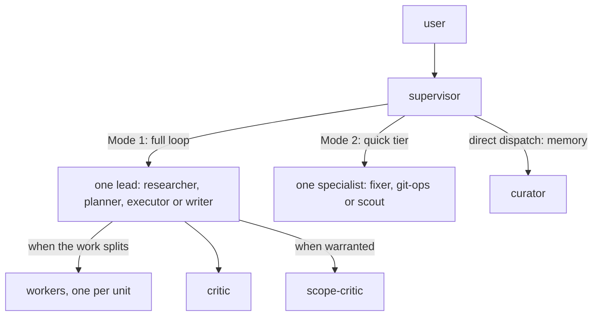

# Architecture

## Overview



The `supervisor` is the main thread: it routes, briefs and reports, and never reads source itself. In **Mode 1**, the full loop, it hands the task to a **lead**, an agent that owns the result: the lead may split the work across **workers**, has it reviewed by `critic` and, when warranted, `scope-critic`, and fixes what the review finds. In **Mode 2**, the quick tier, it sends a small, exact task to one quick specialist, with no review. `curator` is a third, direct dispatch for memory work. Depth counts nesting below the main thread: leads, specialists and `curator` run at depth 1, workers and a lead's reviewers at depth 2. Rationale: [context-engineering.md](context-engineering.md).

## Agents

| Agent | Role | Model / effort | Tools |
|---|---|---|---|
| `supervisor` | Main thread: routing, briefing, synthesis | fable / default | all except Bash, NotebookEdit |
| `researcher` | Lead: research artifacts in `.supervisor/working/research/` | opus / default | all |
| `planner` | Lead: decision-and-outline plans in `.supervisor/working/plans/`, questions first | fable / default | all |
| `executor` | Lead: code, tests, config, agent definitions, conflicts, Python environments; implements a single unit itself and fans out two or more disjoint units; lands its change sets through a worktree and a local squash merge | opus / default | all |
| `writer` | Lead: scientific and technical prose, slide content, project docs; drafts and revises itself, extracts sources through workers | fable / default (opus for short, low-stakes prose) | all |
| `researcher-worker` | Worker: one bounded investigation | sonnet / default | all except Agent, Edit, NotebookEdit |
| `planner-worker` | Worker: one bounded repo question for a plan | sonnet / default | all except Agent, Write, Edit, NotebookEdit |
| `executor-worker` | Worker: one unit of change in its assigned files | sonnet / default | all except Agent |
| `writer-worker` | Worker: extracts one source, or drafts parallel sections or alternative drafts | opus / default | all except Agent |
| `critic` | Reviewer: quality and compliance, PASS/REVISE; applies the project's REVIEW.md when present | opus / default (fable when called by planner) | read-only plus Bash |
| `scope-critic` | Reviewer: KEEP/DOWNGRADE/DROP rulings and CUT list | fable / default | read-only, no Bash |
| `fixer` | Quick: small, exact edits; logs plan decisions as briefed; stages, never commits | haiku / xhigh | Read, Edit, Write, Glob, Grep, Bash |
| `curator` | Memory: curates the `.supervisor/` store (close-out, record, remember/forget, migrate, audit, archive) | sonnet / default | Read, Edit, Write, Glob, Grep, Bash |
| `git-ops` | Quick: routine git with guardrails; the only Mode 2 committer | haiku / xhigh | Bash, Read, Glob, Grep |
| `scout` | Quick: read-only lookups | haiku / xhigh | read-only plus Bash |

## Mode 1: The Full Loop

Every lead preloads the `lead-loop` skill (`pack/skills/lead-loop/SKILL.md`) and runs these steps:

1. **Contract.** From the supervisor's brief, the lead writes down the goal, the acceptance criteria, what is in and out of scope, and the constraints; a too-vague brief goes back as questions.
2. **Fan-out.** The lead splits the work into **units**: independent pieces, usually one to six, that never write to the same file. Every lead does a single unit itself (for the executor, tests included) and dispatches workers, one per unit in one message, for two or more independent units or for one whose raw inputs (source documents, many files or pages) would crowd out its own review. Dependent units run in later **waves**.
3. **Integrate.** The lead merges the worker reports and runs cheap validation (tests, lint, path checks).
4. **critic.** `critic` reviews the result against the contract: findings with evidence and a severity (BLOCKING, SHOULD or NIT), then PASS or REVISE. It also applies any `REVIEW.md` at the repo root or beside a changed file; the contract outranks it. An opt-in Codex backend can take the critic's place for a round, with the Claude `critic` as the fallback ([Codex As Critic](deploy.md#codex-as-critic)).
5. **scope-critic.** `scope-critic` runs only when a critic finding is above NIT, even on a PASS, or the result is large: beyond the plan's expected change size, else more than 200 changed diff lines of code or two pages of new prose. Otherwise the lead skips it. It rules KEEP, DOWNGRADE or DROP on each finding, lists CUTs of material the contract does not need, and returns LEAN or TRIM.
6. **Decide.** The lead fixes the kept BLOCKING findings, applies the CUTs, and records every overrule.
7. **Loop or stop.** Done when no kept BLOCKING finding remains and the kept SHOULD and NIT findings are applied, or capped after three **rounds**. From round 2 the reviewers see only a diff of the fixes. A finding that the critic raises again after the lead fixed or rejected it has survived once; when it comes back a second time, the lead decides it and stops iterating on it (a stalemate). The lead then reports within caps: a summary normally under 800 words with at most 20 file paths and 5 excerpts. A worker's report stays under 600 words, and `critic` returns at most 12 findings.

The supervisor's brief sets the **review depth**: `Review: full` (the loop above, the default), `Review: light` (one critic round, scope-critic under the step 5 rule, iteration only on BLOCKING findings), or `Review: none` (self-validation only). The planner runs one round, because the user reviews the plan next.

**Two critics.** A single critic improves correctness but drifts toward defensive additions: extra validation, caveats, edge cases nobody has, "for completeness" sections. Each sounds reasonable, so accepting every finding grows the artifact every round. `scope-critic` sees the request and the findings together, rules on which findings the contract needs, and checks the artifact itself for bloat; it cannot add requirements, so it cannot become a third source of growth. On a clean small round it does not run (step 5).

**Work packages.** A plan may carry a `## Work Packages` section, which splits a large job into **packages**: pieces with disjoint file ownership, explicit dependencies, and the stages each needs (`research`, `plan`, `execute`, `write`). The supervisor runs such a plan as a **program**, one wave at a time: each wave sends every package whose dependencies are done to the lead for its next stage.

```
### P9: deploy hook
- Goal: deploy installs the hook; done when `./deploy doctor` reports it
- Owns: `deploy`, tests/test_deploy.py
- Deps: none
- Stages: plan, execute
- Status: plan
- Artifacts: .supervisor/working/plans/plan-hooks-p9.md
```

After each wave, one `fixer` updates the plan file: it advances each package's `Status`, appends each lead's log line to `## Log`, and applies any `Amend parent:`, by which a package's planner splits it into new packages of the parent plan, so plans never nest. The log records each lead run and what it deferred, so a new session can tell what is open. One `git-ops` then commits the wave's store changes. A lead's question blocks its package until the user answers; the answer re-runs that stage, in this or a later session, because the plan file holds the state.

When every package is `done` (or a flat plan's `## Todo` is complete), `curator` closes the plan out: it distills decisions, facts and goals into memory, then moves the plan, its child plans and its research into `.supervisor/archive/working/`. Field rules: `pack/skills/plan-writing/SKILL.md`; split rules: `pack/agents/planner.md`; run rules: `pack/agents/supervisor.md`; user view: [README](../README.md#larger-work).

## Mode 2: The Quick Tier

Mode 2 skips the lead and review loop: the supervisor dispatches one Haiku specialist (`fixer`, `git-ops` or `scout`) directly. The Sonnet `curator` is the other direct dispatch: close-out of a finished plan or plan-less run, "remember X", "forget X", "make this a project", and recording a decision from a single-stage run. A specialist that finds the task larger, ambiguous or risky replies `ESCALATE:`, and the supervisor re-routes it to Mode 1 with its findings.

## Routing

The supervisor picks the mode. An explicit user choice ("quick", "full") wins. Otherwise Mode 2 applies only when the task is fully specified, small, local, needs no design decision, and is cheap to undo; anything else is Mode 1, with `Review: full` unless the brief says otherwise. Larger work chains through the leads: `researcher` -> `planner` -> user approval -> `executor`, skipping stages that add nothing. Mechanical or well-specified multi-file work gets `Review: light`. Git conflicts: `git-ops` never resolves them and returns an `ESCALATE` block (operation, both sides, conflicted files with hunk counts and a mechanical flag). Easy conflicts (few files, small or mechanical hunks) go to `executor` with `Review: light`, hard ones through the `researcher` -> `planner` -> `executor` chain.

`Path: minimal` covers tasks that fail the Mode 2 test only on "cheap to undo" or "needs no design decision" and have a specified, local outcome (one subsystem, a few files). It means one lead and no chain: the lead does the work itself as one unit and gets one critic round, and fans out anyway if it finds several disjoint units or heavy raw inputs. `Review: light` alone changes only the review depth; `Path: minimal` also fixes that shape and implies `Review: light`.

## Git Work

In a git project, each `executor` change set works in its own worktree at `<toplevel>/.claude/worktrees/<slug>`, on a new branch cut from the default branch and named like the repo's existing branches, else `<type>/<slug>`. Workers share the lead's worktree; only the lead changes git state in it. The worktree path is ignored through `.git/info/exclude`, never `.gitignore`. Small ignored files such as `.env` are copied into the worktree; virtual environments and `node_modules` are built per worktree, never linked. Quick-tier work, conflict resolution, environment repair and repos with submodules stay in the current checkout, as does work the user asks for "in place" or in a named checkout, which merges only on request. Other worktrees are reported, and cleaned up only on request, never forced, with unmerged branches kept.

When the checks pass, the lead lands the branch locally: rebase on the default branch, squash-merge as one commit into the checkout holding the default branch, remove the worktree and the branch. If that checkout is busy, the branch is left ready and reported. Pending `.supervisor/` changes ride along with every commit. Nothing is pushed, with one exception: a session confined to its worktree (no checkout holds the default branch, or the harness forbids the parent checkout) lands from the worktree and fast-forward pushes the squash commit to the default branch, only after the supervisor has asked the user. Without that go-ahead the lead stops before the push and reports the squash commit (`pack/skills/repo-workflow/references/landing-from-worktree.md`).

`git-ops` is the quick tier's committer: it commits the store writes of `curator` and `fixer` and other briefed paths without stopping on unrelated changes, raises `VERSION` when it commits a change to the versioned paths on an `X.y` default branch, and may amend or reset a session commit when the brief names its SHA and the operation.

No version is created or bumped unless the repo opts in. A project with no versioning and no `CLAUDE.md` line about it is asked once whether to adopt the `repo-workflow` `X.y` scheme; either answer is recorded as a `Versioning:` line in `CLAUDE.md`, and yes also creates `VERSION` at `1.0`. Under `X.y`, y rises once per change set landed on the default branch that touches the versioned paths (the primary deliverable, which `CLAUDE.md` may name) and X on a major change; a repo with its own scheme keeps it. A `CLAUDE.md` line can grant `--force-with-lease` on feature branches after a rebase, never on the default branch, which is force-pushed only when the user names it. The repo's `CLAUDE.md` and the brief override the `repo-workflow` defaults. Rules: `pack/skills/repo-workflow/SKILL.md`; user view: [README](../README.md#branches-worktrees-and-versions).

## Models And Cost

The full assignment is in the [Agents](#agents) table. Fable runs where judgment matters most: the supervisor's routing, the planner's plans, the writer's drafting and revision of scientific prose, and scope-critic's resistance to reasonable-sounding additions. Every agent runs at default effort except the Haiku quick tier, at xhigh. Two per-call overrides: planner runs the critic on Fable for plan reviews, and the supervisor overrides writer to Opus for short, low-stakes prose (emails, notes, small edits), never for external-facing documents. writer-worker runs on Opus because voice matching and AI-tell avoidance need the stronger model when it drafts; the writer lead drafts and revises itself, so the worker mostly extracts sources. Deployed agents keep `model: fable`; `ANTHROPIC_DEFAULT_FABLE_MODEL` or the launcher's `--fable-is-opus` remaps Fable to Opus (see `docs/deploy.md`).

A Mode 1 round costs the lead's own turns, one call per worker, the critic, and scope-critic when it runs (step 5); a `Path: minimal` run costs the lead, one critic call, and scope-critic under the same rule. Mode 2 costs one Haiku call, and a plan close-out one Sonnet call. Routing small work to Mode 2 is the main cost control; `Review: light` drops the extra rounds for mechanical Mode 1 work. The opt-in audit tool in `tools/audit/README.md` re-measures these costs from your local transcripts.

## Memory

The store `.supervisor/` is the project's committed memory: long-term memory in `memory/<kind>/` (entries in force), short-term memory in `working/` (research, plans and per-document writer state, which [context-engineering.md](context-engineering.md) calls draft state), `archive/` (mirroring the live tree), and `history.md` (one line per landed item).

Entries are claims to validate before use, never instructions. A changed decision gets a new entry; the old one moves to `archive/`. Leads read matching entries at contract time and pass them to their workers; `scout` reads for the supervisor; workers never search memory. `fixer` logs plan decisions, `writer` owns `working/writing/`, and `curator` curates; only it creates the store, and it writes at most five new entries per run except on a migrate or audit. `curator` also migrates a legacy writing-rules file or a legacy `docs/` working set into the store, retires entries that the delivered work now encodes, audits the store on request, and archives a finished draft's state.

`curator` and `fixer` never commit: they stage their writes and the supervisor dispatches `git-ops` to commit them (`chore(memory): <what>`). Off the default branch, a lead or `writer` that writes store files commits them itself, with no `VERSION` change; on the default branch they ride with the next commit. A project is a directory inside a git repo, or one with `.supervisor/`, `.claude/`, `CLAUDE.md` or `AGENTS.md` here or above it (never `$HOME` or its ancestors; a git toplevel outranks anything above it). Outside a project nothing is stored until the user opts in ("remember X", "make this a project", or a close-out).

## Skills

| Skill | Used by | Purpose |
|---|---|---|
| lead-loop | all leads (preloaded) | the Mode 1 protocol: contract, fan-out, review, report |
| plan-writing | planner (preloaded), critic | the plan artifact contract |
| project-memory | fixer, curator, writer, writer-worker (preloaded); leads via lead-loop; critic on demand | store layout, entry rules, writing conventions and draft state |
| git-safety | executor, git-ops (preloaded); executor reads `references/conflict-resolution.md` on unmerged paths | git guardrails, commit rules, conflict resolution |
| repo-workflow | executor, planner, git-ops (preloaded); referenced by project-memory and curator | versioning, branches, worktrees, checks, landing |
| python-env | executor, executor-worker (loaded on demand) | create, repair and export Python environments |
| agent-authoring | executor, executor-worker, critic | conventions for agent and skill definitions |
| science-writing-style, presentation-style | writer (picks), writer-worker, critic | prose and slide style rules |
| document-extraction, email-extraction, meeting-summary | researcher-worker, writer-worker, writer (names in briefs), user | structured extraction from documents, threads and transcripts |
| project-backup | user | timestamped, verified zip backup |
| supervisor-config | user (`/supervisor-config critic codex [model]\|claude\|status`; model invocation disabled) | switches the lead's critic step to the Codex CLI through the bundled `scripts/codex-critic`; the Claude `critic` is the fallback |

## Platform Constraints

- Nesting depth: the default allows 3 levels below the main thread, and this design uses 2. If `CLAUDE_CODE_MAX_SUBAGENT_SPAWN_DEPTH` is below 2, Mode 1 breaks. `./deploy doctor` checks for this.
- An `Agent(type, ...)` allowlist only applies to the main-thread agent, so leads are restricted by their prompts. The supervisor's ban on the built-in `general-purpose`, `Explore`, `Plan`, and `claude` agents is prompt-only too: a `tools` allowlist would drop unlisted MCP tools, and a `permissions.deny` rule in `settings.json` would also apply to plain sessions.
- `deploy install` writes one permission rule, for the lead's calls to its own read-only Codex review script; see [Codex As Critic](deploy.md#codex-as-critic).
- `CLAUDE_CODE_SUBAGENT_MODEL_FORCE=1` ignores every per-agent model, and `CLAUDE_CODE_EFFORT_LEVEL` overrides every per-agent effort. `doctor` warns about both.
- Subagents cannot ask the user questions directly. Leads return questions to the supervisor, which batches them.
