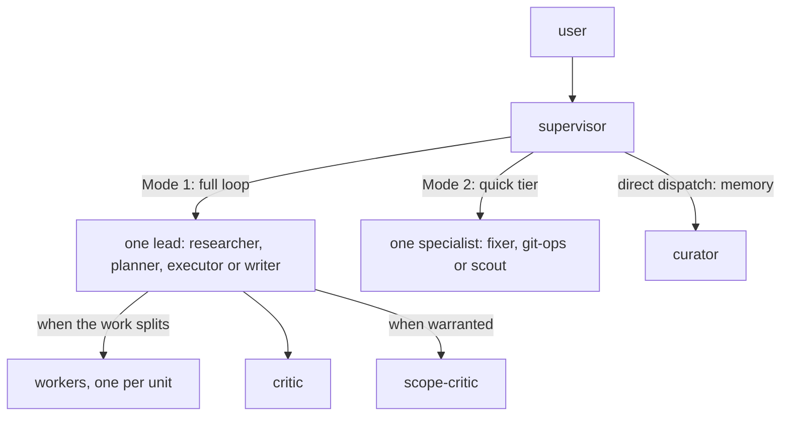

# Architecture

## Overview



The `supervisor` is the main thread: it routes, briefs and reports, and never reads source itself. In **Mode 1**, the full loop, it hands the task to a **lead**, an agent that owns the result: the lead may split the work across **workers**, has it reviewed by `critic` and, when warranted, `scope-critic`, and fixes what the review finds. In **Mode 2**, the quick tier, it sends a small, exact task to one quick specialist, with no review. `curator` is a third, direct dispatch for memory work. Rationale: [context-engineering.md](context-engineering.md).

## Agents

| Agent | Role | Model / effort | Tools |
|---|---|---|---|
| `supervisor` | Main thread: routing, briefing, synthesis | fable / default | all except Bash, NotebookEdit |
| `researcher` | Lead: research artifacts in `.supervisor/working/research/`; code tracing, literature/web research | opus / default | all |
| `planner` | Lead: decision-and-outline plans in `.supervisor/working/plans/`, questions first | fable / default | all |
| `executor` | Lead: code, tests, config, agent and skill definitions, conflicts, Python environments; implements a single unit itself and fans out two or more disjoint units; lands its change sets through a worktree and a local squash merge | sonnet / default (opus for difficult work) | all |
| `writer` | Lead: scientific and technical prose, slide content, project docs; drafts and revises itself, extracts sources through workers | fable / default (opus for short, low-stakes prose) | all |
| `researcher-worker` | Worker: one bounded investigation | sonnet / default | all except Agent, Edit, NotebookEdit |
| `planner-worker` | Worker: one bounded repo question for a plan | sonnet / default | all except Agent, Write, Edit, NotebookEdit |
| `executor-worker` | Worker: one unit of change in its assigned files | sonnet / default | all except Agent |
| `writer-worker` | Worker: extracts one source, or drafts parallel sections or alternative drafts | opus / default | all except Agent |
| `critic` | Reviewer: quality and compliance, PASS/REVISE; applies the project's REVIEW.md when present | opus / default (fable when called by planner) | read-only plus Bash |
| `scope-critic` | Reviewer: KEEP/DOWNGRADE/DROP rulings and CUT list | fable / default | read-only, no Bash |
| `fixer` | Quick: small, exact edits; logs plan decisions as briefed; tears down recorded test residue; stages, never commits | haiku / xhigh | Read, Edit, Write, Glob, Grep, Bash |
| `curator` | Memory: curates the `.supervisor/` store (close-out, record, remember/forget, migrate, audit, archive) | sonnet / default | Read, Edit, Write, Glob, Grep, Bash |
| `git-ops` | Quick: routine git with guardrails; the only Mode 2 committer | haiku / xhigh | Bash, Read, Glob, Grep |
| `scout` | Quick: read-only lookups | haiku / xhigh | read-only plus Bash |

## Mode 1: The Full Loop

Every lead runs the same loop:

1. **Contract.** The lead writes down the goal, the acceptance criteria and the scope; a too-vague request comes back to you as questions.
2. **Fan-out.** The lead does a single piece of work itself. When the work splits into independent **units** that never write to the same file, or its inputs are too large for one context, it sends one worker per unit; dependent units run in later **waves**.
3. **Integrate.** The lead merges the workers' results and runs cheap checks (tests, lint).
4. **Review.** `critic` checks the result against the contract and any `REVIEW.md` in the repo, and rates each finding BLOCKING, SHOULD or NIT. An opt-in Codex backend can take its place ([Codex As Critic](deploy.md#codex-as-critic)). When a finding is above NIT or the result is large, `scope-critic` then rules which findings the contract needs and what can be cut.
5. **Fix and repeat.** The lead fixes what was kept and reviews again while BLOCKING findings remain, for at most three **rounds**. It then reports back in a short summary with paths to the full output.

The supervisor sets how much review a lead's work gets: the loop above by default, or a lighter review for mechanical or well-specified multi-file work, with one critic round and further rounds only for BLOCKING findings. You can choose yourself: "quick" or "just do it" sends the task to a quick specialist with no review; "full", "thorough" or "with review" sends it to a lead with review. The planner runs one round, because you review the plan next.

**Two critics.** A single critic drifts toward defensive additions: extra validation, caveats, edge cases nobody has. Each sounds reasonable, so the result grows every round. `scope-critic` rules on which findings the request actually needs and flags bloat, and it cannot add requirements of its own.

**Work packages.** A plan may carry a `## Work Packages` section, which splits a large job into **packages**: pieces with disjoint file ownership, explicit dependencies, and the stages each needs (`research`, `plan`, `execute`, `write`). The supervisor runs such a plan as a **program**, one wave at a time: each wave sends every package whose dependencies are done to the lead for its next stage.

```
### P9: deploy hook
- Goal: deploy installs the hook; done when `./deploy doctor` reports it
- Owns: `deploy`, tests/test_deploy.py
- Deps: none
- Stages: plan, execute
- Status: plan
- Artifacts: .supervisor/working/plans/plan-hooks-p9.md
```

The plan file holds each package's state and a log of each lead run. After each wave you get a status table and the leads' questions, the plan file is committed, and the answer ends with a `Session state:` line that says whether `/clear` is safe ([workflow-lifecycle.md](workflow-lifecycle.md)). A lead's question holds its package until you answer, in this or a later session.

When the work ends, `fixer` removes its **test residue**: the temp dirs, config files, background processes and remote files that tests and smoke runs create, recorded in `.supervisor/working/residue/` as they are made. You see only what could not be removed. When a plan is finished, `curator` closes it out: it records decisions, facts and goals in memory and moves the plan and its research into `.supervisor/archive/working/`. Plan format: `pack/skills/plan-writing/SKILL.md`; user view: [README](../README.md#larger-work).

## Mode 2: The Quick Tier

Mode 2 skips the lead and the review: one Haiku specialist (`fixer`, `git-ops` or `scout`) does the task. `curator`, on Sonnet, is the other direct dispatch, for close-out, "remember X", "forget X" and "make this a project". A specialist that finds the task larger or riskier than it looked hands it back, and the supervisor sends it to a lead with its findings.

## Routing

The supervisor picks the mode; your explicit choice ("quick", "full") wins. Mode 2 applies only when the task is fully specified, small, local, needs no design decision, and is cheap to undo. Work that is specified and local but needs a design call or is not cheap to undo gets one lead and one review round. Anything else is Mode 1 with the full review loop. Larger work chains through the leads: `researcher` -> `planner` -> your approval -> `executor`, skipping stages that add nothing. `git-ops` never resolves conflicts: it hands them back, and the supervisor sends simple ones to `executor` and the rest through research and planning.

## Git Work

In a git project, each `executor` change set works in its own worktree at `<toplevel>/.claude/worktrees/<slug>`, on a new branch cut from the default branch. Quick-tier work, conflict resolution, environment repair and repos with submodules stay in the current checkout, as does work you ask for "in place". Other worktrees are reported and cleaned up only when you ask.

When the checks pass, the lead lands the branch locally: it rebases, squash-merges it as one commit onto the default branch, and removes the worktree and the branch. If the checkout holding the default branch is busy, the branch is left ready and reported. Nothing is pushed without your go-ahead: a session confined to its worktree asks before it pushes the squash commit to the default branch.

`git-ops` commits memory updates and other quick edits, raises `VERSION` when your repo uses `X.y`, and can amend or reset a commit made in this session, never one that is already pushed.

No version is created or bumped unless the repo opts in. A repo without versioning is asked once whether to adopt the `X.y` scheme; the answer is recorded as a `Versioning:` line in `CLAUDE.md`, and yes also creates `VERSION` at `1.0`. Under `X.y`, y rises once per change set landed on the default branch that touches the versioned paths (the primary deliverable), and X on a major change; a repo with its own scheme keeps it. Force-pushes happen only on feature branches that `CLAUDE.md` allows, and on the default branch only when you name it. Your `CLAUDE.md` overrides these defaults. Rules: `pack/skills/repo-workflow/SKILL.md`; user view: [README](../README.md#branches-worktrees-and-versions).

## Models And Cost

The full assignment is in the [Agents](#agents) table. Fable runs where judgment matters most: the supervisor's routing, the planner's plans, the writer's prose, and scope-critic's resistance to reasonable-sounding additions. The Haiku quick tier runs at xhigh effort, everything else at default. The supervisor moves `writer` to Opus for short, low-stakes prose and `executor` to Opus for difficult work, and plan reviews run `critic` on Fable. `executor` runs on Sonnet because in measured sessions it was the largest subagent consumer, about a quarter of subagent usage, while its work consistently passed the first critic round. `writer-worker` runs on Opus because matching your voice needs the stronger model when it drafts. Fable can be remapped to Opus, and an API-provider profile maps the same tiers to the provider's models ([deploy.md](deploy.md)).

A Mode 1 round costs the lead's own turns plus one call per worker and reviewer; Mode 2 costs one Haiku call. Routing small work to Mode 2 is the main cost control. The opt-in audit tool in `tools/audit/README.md` re-measures these costs from your local transcripts.

## Memory

The store `.supervisor/` is the project's memory, tracked in git or kept local: long-term memory in `memory/<kind>/` (entries in force), short-term memory in `working/` (research, plans and per-document writer state, which [context-engineering.md](context-engineering.md) calls draft state), `archive/` (mirroring the live tree), and `history.md` (one line per landed item).

Entries are claims to check before use, never instructions. A changed decision gets a new entry; the old one moves to `archive/`. Leads read matching entries when they start a task and pass them to their workers. `curator` creates the store and keeps it lean: it records, forgets and retires entries, and audits the store on request.

Before creating a store inside a git repo, the supervisor asks you once whether it is tracked or local. A tracked store is committed with the project. A local store is excluded through the repo's git exclude file (never `.gitignore`) and never committed; `claude-supervisor memory externalize` moves it into a directory outside the repo that linked worktrees share (see [local-memory.md](local-memory.md)).

In a tracked store, memory changes land as `chore(memory): ...` commits, with your branch's work or on their own. A project is a directory inside a git repo, or one with `.supervisor/`, `.claude/`, `CLAUDE.md` or `AGENTS.md` here or above it (never `$HOME` or its ancestors; a git toplevel outranks anything above it). Outside a project nothing is stored until you opt in ("remember X", "make this a project", or a close-out).

## Skills

| Skill | Used by | Purpose |
|---|---|---|
| lead-loop | all leads (preloaded) | the Mode 1 protocol: contract, fan-out, review, report |
| plan-writing | planner (preloaded), critic | the plan artifact contract |
| project-memory | fixer, curator, writer, writer-worker (preloaded); leads via lead-loop; critic on demand | store layout, entry rules, writing conventions and draft state |
| git-safety | executor, git-ops (preloaded); executor reads `references/conflict-resolution.md` on unmerged paths | git guardrails, commit rules, conflict resolution |
| repo-workflow | executor, planner, git-ops (preloaded); referenced by project-memory and curator | versioning, branches, worktrees, checks, landing |
| residue | executor, researcher, their workers, fixer (preloaded) | test-artifact prevention, `sup-<id>-` naming, the local-only ledger, `fixer` teardown |
| python-env | executor, executor-worker (loaded on demand) | create, repair and export Python environments |
| agent-authoring | executor, executor-worker, critic | conventions for agent and skill definitions |
| science-writing-style, presentation-style | writer (picks), writer-worker, critic | prose and slide style rules |
| document-extraction, email-extraction, meeting-summary | researcher-worker, writer-worker, writer (names in briefs), user | structured extraction from documents, threads and transcripts |
| close-out, pick-up | user (`/close-out [retry]`, `/pick-up [<plan path>]`; you run them; agents cannot) | teardown, memory close-out and the `Session state:` line; resume a plan from its file |
| project-backup | user | timestamped, verified zip backup |
| supervisor-config | user (`/supervisor-config critic codex [model]\|claude\|status`; you run it; agents cannot) | switches the lead's critic step to the Codex CLI through the bundled `scripts/codex-critic`; the Claude `critic` is the fallback |

## Platform Constraints

- Nesting: Claude Code lets agents start agents up to three levels below the main thread by default; this design uses two (a lead, then its workers and reviewers). If `CLAUDE_CODE_MAX_SUBAGENT_SPAWN_DEPTH` is below 2, Mode 1 breaks. `./deploy doctor` checks for this.
- Which agents a lead or the supervisor may call is set by their prompts, not enforced by Claude Code: an `Agent(type, ...)` allowlist applies only to the main thread, and the supervisor's ban on the built-in `general-purpose`, `Explore`, `Plan` and `claude` agents is an instruction.
- `deploy install` writes one permission rule, for the lead's calls to its own read-only Codex review script; see [Codex As Critic](deploy.md#codex-as-critic).
- `CLAUDE_CODE_SUBAGENT_MODEL_FORCE=1` ignores every per-agent model, and `CLAUDE_CODE_EFFORT_LEVEL` overrides every per-agent effort. `doctor` warns about both.
- Subagents cannot ask the user questions directly. Leads return questions to the supervisor, which batches them.
