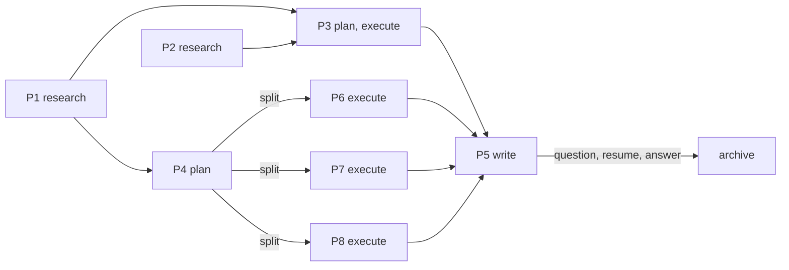

# Plan: Work Packages (WBS) For Long-Horizon Work

Reconsidered against HEAD ae6d00f (VERSION 1.1). Every anchor below is a line number at that HEAD.

## Goal

Let a plan carry a work breakdown structure, `## Work Packages`, whose packages run as independent, parallel chains (research -> plan -> execute/write, each stage optional) under `supervisor`, with the parent plan file as the only program state so a fresh session can resume it, and with depth bounded structurally (child plans never contain packages).

## Approach

- The plan format grows one optional section, `## Work Packages`, owned by `planner`. Each package is a block of six fields (Goal, Owns, Deps, Stages, Status, Artifacts). Stage names map onto the four leads, so there is no "lead" field.
- `supervisor` gets a short `## Programs` section: each wave dispatches the next stage of every package whose `Status` names a stage and whose `Deps` are `done`; one `quick-edit` call writes the new `Status` lines back; the user sees a table per wave. The supervisor never reads the plan file: its state is one line per package (id, Deps, Stages, Status, Artifacts), returned by `planner`, or by one `scout` call on resume.
- The parent plan has one writer at a time. Leads write only their package's artifact; a `planner` that finds a package should split returns an `Amend parent:` block, which `supervisor` applies through the same serialized `quick-edit`.
- Finished plans are archived: `quick-edit` runs `git mv` of the plan, its child plans, and its research docs to `docs/archive/`, filenames unchanged. Top-level `docs/plan-*.md` means live; `planner` treats archived research as not fresh.
- The README gets a `## Work Packages` section (why, the block, three mermaid diagrams) because the breakdown is part of the pack's core approach; `docs/architecture.md` gets a two-sentence pointer.
- Simplicity is a criterion of this change: new agent lines are short bullets (target 100 chars, hard check 110), stated once, and the three agent files grow by 21, 6, and 1 body lines (`planner.md` 38 -> 59, `supervisor.md` 70 -> 76 after tightenings, `executor.md` 36 -> 37).
- Rejected: a coordinator agent (user decision: supervisor owns the loop); continuous per-return advancement instead of waves (unbounded report cadence, harder resume); a `program-loop` skill or reference file (supervisor preloads no skills, and the rules fit in eight bullets); `planner` status sync per transition (fable/xhigh for a one-line edit); supervisor editing plans itself (breaks "all project changes go through agents").
- Cut in this reconsideration: `git-ops` gaining `mv` (git-ops.md:12 says it never edits working-tree files, so the change would not stop at the description; `quick-edit` already runs a given command, quick-edit.md:16, and `git-safety` does not gate `git mv`); report-cap clauses in scout.md and quick-edit.md (the supervisor's state is one line per package, which fits both caps; the wave-closing `quick-edit` returns nothing the supervisor did not dictate); the `## Work Packages` phrase lint (a presence check with no failure mode the existing lints do not already model; the critic reads the files); the `## Todo` mirror of package status (duplicate state, two edits per transition); the `pending`/`running:` status pair (one `<stage>` value serves dispatch and resume with a single ready rule); glue in the parent's `## Orchestration` (integration is itself a package, so the loop has one kind of thing); a line-length lint (see Risks).

## Files

Modify:
- `pack/agents/planner.md`: one `## Artifact` bullet; new `## Work Packages` section (schema and rules); archive clause in Fan-Out; status sync and Final Output sentences rewritten.
- `pack/agents/supervisor.md`: new `## Programs` section; five tightenings to hold 76 body lines; two existing sentences rewritten.
- `pack/agents/executor.md`: one bullet in `## Scope`.
- `README.md`: new `## Work Packages` section after `## How It Works`; one `docs/archive/` row in `## Repository Layout`.
- `docs/architecture.md`: one short paragraph after `## Mode 1: The Lead Loop`.
- `VERSION`: 1.1 -> 1.2 (CLAUDE.md:10: the editing agent bumps once per change set, before running the tests).

Unchanged, by decision: `pack/agents/researcher.md`, `pack/agents/writer.md`, `pack/agents/git-ops.md`, `pack/agents/scout.md`, `pack/agents/quick-edit.md`, `pack/skills/lead-loop/SKILL.md`, `pack/skills/agent-authoring/SKILL.md`, `tests/test_pack_lint.py`, the README inventory table and version lines (README.md:27, 112).

## Interfaces And Data Changes

### 1. `## Work Packages` schema

Stated once, in `planner.md` (Interfaces 5); everything else refers to it. Placed after `## Scope Notes` in a plan. One block per package:

```
### P1: <name>
- Goal: <one sentence>; done when <criterion>
- Owns: <files or area, disjoint across packages>
- Deps: none | <package ids>
- Stages: <ordered subset of research, plan, execute, write>
- Status: <stage due next> | blocked: <stage>: <why> | done
- Artifacts: <docs/research-<topic>-<id>.md, docs/plan-<topic>-<id>.md, a draft path, or ->
```

Two facts the schema line implies: `planner` fills `Artifacts` at plan time, so `supervisor` takes output paths from it and never carries the convention; a `write` package's draft is a deliverable and is never archived. `<topic>` is the parent plan's topic (`docs/plan-wbs.md` -> `docs/plan-wbs-p1.md`); `<id>` is lower-cased.

### 2. Package brief (supervisor -> lead), on top of the normal Mode 1 brief

```
Program: docs/plan-<topic>.md, package <id>: its block is the contract; the plan's Scope Notes bind.
Stage: research | plan | execute | write
Inputs: <Artifacts of each package in Deps>
Output: <this package's Artifacts path for the stage; for execute, the plan to follow: its own child plan, or one in Inputs>
```

The lead reads its block and the Scope Notes from the plan; `supervisor` holds only the state line. The wave-closing `quick-edit` brief is a normal Mode 2 brief by package id and field, for example: "In `docs/plan-wbs.md` under `### P2`, replace `- Status: plan` with `- Status: execute`; under `### P1`, `- Status: research` with `- Status: done`. Report the changed lines." The archive brief is a given command: "Run `mkdir -p docs/archive && git mv docs/plan-wbs.md docs/plan-wbs-p2.md docs/research-wbs-p1.md docs/archive/` and report `git status --short`."

### 3. `Amend parent:` block (planner report, child-plan stage only)

```
Amend parent: docs/plan-<topic>.md
- add: <complete ### <id> blocks, Status at their first stage, appended to ## Work Packages>
- <id> <Field>: <new value>      (one line per changed line, e.g. P5 Deps: P3, P6, P7, P8)
```

A package split out of another lists it in `Deps` (`P6 Deps: P4`), so its `execute` brief carries the split package's child plan in `Inputs`. `supervisor` passes the block to the wave-closing `quick-edit` as given edits. An amendment beyond quick-edit's limits (about 40 lines) comes back as `ESCALATE`, which supervisor.md:36 already re-routes to Mode 1: a `planner` annotation cycle on the parent.

### 4. State exchange

`supervisor` never reads a plan. Its state is one line per package with id, Deps, Stages, Status, Artifacts, which it also shows the user as the per-wave table (`package | deps | stages | status | artifacts`). Sources: `planner` ends its report with those lines after writing or amending a parent plan; after each wave `supervisor` knows the new state because it dictated the edits (the `quick-edit` report only confirms them); on resume, one `scout` call returns the lines from the plan's `## Work Packages`.

### 5. Agent file text (executor applies these; wording may be tightened, meaning may not)

`pack/agents/planner.md` (body 38 at HEAD; 59 after):

- After line 22 (the `## Scope Notes` bullet), add one contents bullet:

```
  - `## Work Packages` (rules below), when the work splits into packages
```

- Line 31, rewrite the clause "unless a fresh `docs/research-*.md` already covers them" as "unless a fresh `docs/research-*.md` already covers them (nothing under `docs/archive/` is fresh)".
- After line 35 (the blank after `## Fan-Out`), before `## Review`, insert:

````
## Work Packages

- Use packages when streams each need their own research, plan, or write stage.
- Plain parallel execution stays a flat plan. Prefer parallel packages; `Deps` are real inputs only.
- One block per package, listing only the stages it needs:

```
### P1: <name>
- Goal: <one sentence>; done when <criterion>
- Owns: <files or area, disjoint across packages>
- Deps: none | <package ids>
- Stages: <ordered subset of research, plan, execute, write>
- Status: <stage due next> | blocked: <stage>: <why> | done
- Artifacts: <docs/research-<topic>-<id>.md, docs/plan-<topic>-<id>.md, a draft path, or ->
```

- Integration work is a package too; a parent plan's `## Orchestration` and `## Todo` point here.
- A child plan is a normal plan for one package at the briefed path, with no `## Work Packages`.
- To split a package, return `Amend parent:` (new blocks, `Deps` on it, changed lines), never a parent edit.

````

- Line 43 (status sync), rewrite "change only checklist state and the minimum adjacent wording" as "change only checklist state, package `Status` lines, and the minimum adjacent wording".
- Line 47 (Final Output), append to the sentence: "; for a parent plan, end with one line per package: id, Deps, Stages, Status, Artifacts".

`pack/agents/supervisor.md` (body 70 at HEAD; 76 after):

- Lines 37-40 (conflict triage), replace with three lines, meaning preserved (line 38 stays as it is; "the full chain below" is the chain bullet at line 42):

```
- `git-ops` escalates a conflict as a block (operation, branches, per-file hunks, mechanical flag). Triage:
  - *Easy* (few files, small hunks, mechanical or non-overlapping): `executor` directly, with `Review: light`.
  - *Hard* (overlapping edits, many files, unclear intent), or `executor` escalating: the full chain below.
```

- Line 42 (chain bullet), append: "; a plan with `## Work Packages` runs per `## Programs`".
- Line 51 (contract bullet), append: ", and decisions the user already made, so leads do not reopen them"; delete line 53.
- After line 58 (the blank after the Mode 2 briefs sentence), before `## Context Preservation`, insert:

```
## Programs

- A plan with `## Work Packages` is a program. Its state: per package, id, Deps, Stages, Status, Artifacts.
- Get that state from `planner`'s report, or from one `scout` call on resume; never read the plan.
- Each wave sends every package whose `Status` is a stage and whose `Deps` are `done` to that stage's lead.
- The brief gives the plan path, the package id (its block is the contract), `Deps` artifacts, output path.
- Then one `quick-edit` advances each finished `Status` (next stage, or `done`) and applies `Amend parent:`.
- A lead's open question sets `blocked: <stage>: <why>`; the user's answer re-runs that stage.
- A plan is finished when every package is `done`, or a flat plan's `## Todo` is complete.
- `quick-edit` moves a finished plan, its child plans, and research docs to `docs/archive/` with `git mv`.

```

- Line 61 (expensive context), append: "; reject oversized or unbounded reports and ask for a refinement"; delete line 63.
- Lines 68 and 70 (User Interaction), replace with one line: "- Default to action; never swap in your own objective. Ask only when a choice is the user's and material."
- Line 72, append: "; in a program, with the package table after each wave".
- Lines 76 and 77 (Final Output), replace with one line: "- One concise integrated answer, not raw agent output: the outcome first, then who handled what in which mode."

Count: 70 - 1 (triage) - 1 (line 53) - 1 (line 63) - 1 (line 70) - 1 (line 77) + 11 (`## Programs`: heading, blank, eight bullets, blank) = 76.

`pack/agents/executor.md` (body 36 at HEAD; 37 after), after line 24 (the "When a plan exists" bullet):

```
- In a work package, edit only its `Owns` and its own child plan's `## Todo`, never another plan.
```

### 6. Documentation text

`README.md`, new section inserted after line 37 (end of `## How It Works`), before `## Agents` (line 39):

````
## Work Packages

Work too large for one plan is broken into packages. Each package is a small project of its own, with only the stages it needs: `research`, `plan`, `execute`, `write`. Packages depend only on the packages whose output they consume, so independent ones run in parallel. The planner writes them as a `## Work Packages` section of the plan; you can ask for either form.

The supervisor runs the packages in waves: every package whose dependencies are done gets its next stage dispatched to that stage's lead, all at once. After each wave one `quick-edit` call records the new status lines, and you see a table of every package plus the questions the leads raised. The plan file is the only state, so a new session resumes from it. A package that needs its own breakdown is split into new packages in the parent plan, so plans never nest and agent depth never grows; when every package is done, the plan, its child plans, and its research move to `docs/archive/`.

A package block (field rules in `pack/agents/planner.md`):

```
### P2: deploy hook
- Goal: deploy installs the hook; done when `scripts/deploy doctor` reports it
- Owns: scripts/deploy, tests/test_deploy.py
- Deps: P1
- Stages: plan, execute
- Status: plan
- Artifacts: docs/plan-hooks-p2.md
```

Three shapes of work.

A single fix needs no packages: one lead, one report, no plan to archive.


A chain, where each package consumes the one before it: six waves, one package each, a table after every wave, then the archive move.


A graph: wave 1 runs P1 and P2 together. P4's plan stage returns `Amend parent:`, which splits it into P6, P7 and P8, each executing P4's plan. P5 asks you a question and blocks; the session ends; a new session asks `scout` for the state, you answer, and P5 runs.


````

`README.md`, `## Repository Layout` (block at lines 106-113), after the `docs/` row (line 111), description column 21 as in the other rows:

```
docs/archive/       finished plans, their child plans and research
```

`docs/architecture.md`, one paragraph inserted after line 38 (end of `## Mode 1: The Lead Loop`), before `## Mode 2: The Quick Tier` (line 40):

```
**Work packages.** A plan may carry a `## Work Packages` section: a breakdown into packages with disjoint ownership, dependencies, and the stages each needs, which the supervisor runs as a program one wave at a time. The rules are in `pack/agents/planner.md` (`## Work Packages`) and `pack/agents/supervisor.md` (`## Programs`); the README's `## Work Packages` section has the diagrams.
```

`VERSION`: `1.1` -> `1.2`.

## Scenario Walk

Only the rules the three scenarios changed:

- Small (single-file fix, flat plan or none): `## Programs` never engages; the "finished" rule covers a flat plan's `## Todo`, so one archive rule serves both forms.
- Medium (four packages in a chain): the three cuts under Approach (status pair, `## Todo` mirror, integration glue).
- Large (parallel research, a split, a blocked write, resume): `blocked: <stage>: <why>` carries enough for a resumed session to re-ask; the user's answer re-runs the asking stage (a `plan` stage as `planner`'s annotation cycle), with no separate persistence; splits get `Deps` on the split package (Interfaces 3).

## Risks And Compatibility

- Supervisor context across many packages: structurally bounded. It holds one line per package and never a plan or a block; leads read their own block from the plan. Scout's 15-line cap bounds resume at about 13 packages.
- Write contention on the parent plan: one `quick-edit` per wave, dispatched alone; leads write only their artifact; `planner` returns amendments instead of editing the parent (planner.md rule).
- Accidental nesting: `planner` rule (child plans never have `## Work Packages`; splits amend the parent). The pack lint cannot inspect project plans; the plan-domain `critic` sees the rule in `planner.md`.
- `planner.md` reaches 59 body lines, at the top of the 30-60 budget; the fenced schema is an output schema, which `agent-authoring` names as a reason to go long. `supervisor.md` holds 76 with the five tightenings (meaning preserved; each is a merge or a shortening of an existing bullet, and the composed lines stay within 110).
- Line length: the pack today has 228 lines over 100 chars (166 over 120; longest body line 609), so a line-length lint would need a reflow of about 200 lines across 14 agents and 11 skills. Not in this change set: inserted lines are short bullets (target 100, checked at 110), and the reflow plus lint is an open question for a separate change set. Short new lines beside 200-400 char neighbours is accepted style drift until then.
- Mermaid: no offline renderer on this machine (`mmdc` absent, `npx --no-install` fails). GitHub renders the blocks natively; validation is the count check plus the critic's syntax review.
- Backward compatibility: plans without `## Work Packages` are unaffected; flat-plan wording in executor, planner, and supervisor is unchanged apart from the archive step.

## Acceptance Criteria

- `pack/agents/planner.md`: body (lines after the closing `---`, blanks included) <= 60; contains the fenced schema with the six fields and the three `Status` forms; the three rules after it (integration is a package, child plan shape, `Amend parent:`); the Artifact bullet; the archive clause in Fan-Out; status sync names `Status` lines; Final Output names the per-package state line.
- `pack/agents/supervisor.md`: body <= 76; `## Programs` has the eight bullets (state, sources and never-read, wave rule, brief, wave-closing `quick-edit`, blocked and answer, finished, archive); the five tightenings and two appended clauses are applied with meaning preserved; no `mv` added to the `git-ops` row.
- `pack/agents/executor.md`: body <= 37; the package bullet present.
- No inserted line in `pack/` longer than 110 characters. Existing lines that gained an appended clause are exempt: planner.md 31, 43, 47 and supervisor.md 42, 51, 61, 72 (seven lines), and the long-line check below must list only those.
- `git diff --stat` shows no change to `pack/agents/researcher.md`, `writer.md`, `git-ops.md`, `scout.md`, `quick-edit.md`, `pack/skills/`, `tests/`, `scripts/`, `CLAUDE.md`, or `docs/deploy.md`.
- `README.md`: the `## Work Packages` section between `## How It Works` and `## Agents`, with exactly three ```mermaid blocks, each starting with `flowchart`; the `docs/archive/` layout row; no change to lines 27 or 112 (version lines) or the inventory table.
- `docs/architecture.md`: the one paragraph, between the Mode 1 and Mode 2 sections; no other change.
- `VERSION` reads `1.2`.
- `python3 -m pytest -q` passes (150 passed, 5 skipped at HEAD), including `tests/test_version.py`.
- `scripts/deploy install --dry-run`, then `scripts/deploy install`, then `scripts/deploy doctor` succeed.

Validation commands:
```
cd /Users/sjoosten/Work/claude-agents
python3 -m pytest -q
for f in planner supervisor executor; do printf '%s ' $f; awk 'c==2{n++} /^---$/{c++} END{print n}' pack/agents/$f.md; done
git diff -U0 -- pack | grep '^+[^+]' | awk 'length($0) > 111 {print length($0)-1": "substr($0, 1, 60)}'
git diff --stat -- pack/agents/researcher.md pack/agents/writer.md pack/agents/git-ops.md pack/agents/scout.md pack/agents/quick-edit.md pack/skills tests scripts CLAUDE.md docs/deploy.md
grep -c '^```mermaid' README.md
grep -n -A1 '^```mermaid' README.md | grep -c 'flowchart'
grep -n 'Work Packages\|docs/archive' README.md docs/architecture.md
cat VERSION
scripts/deploy install --dry-run && scripts/deploy install && scripts/deploy doctor
```
Expected: body counts 59, 76, 37; the long-line check lists exactly the seven exempt lines; the `--stat` is empty; the two mermaid counts are 3 and 3; `VERSION` is `1.2`.

## Scope Notes

- In scope: the six files under Modify, with the text in Interfaces 5 and 6.
- Out of scope: the files listed as Unchanged; new agents or skills; model or tier changes; a phrase lint or a line-length lint; the versioning design (04bde23; `VERSION` is bumped, not redesigned); cron or scheduling.
- No new rules beyond those in Interfaces 5. No tier taxonomies. No persistence features (decisions log, run logbook, Assumptions, Issues, or RAID sections) in this change.
- Creep to resist during execution: a new skill or reference file for the WBS procedure; an archive index, retention rule, or lint for `docs/archive/`; extra package fields (owner, estimate, priority) or status values (`pending`, `ready`, `waiting`); a stage -> lead table in `supervisor.md` (the names say it); explaining the schema again in `supervisor.md` or the README (the schema lives in `planner.md`, the README shows a filled example); rewriting supervisor sections beyond the five named tightenings; letting `supervisor` edit or read plan files; adding a fourth diagram or a sequence diagram; reflowing existing long lines (a separate change set).
- Decisions already made (do not reopen): `supervisor` runs the chains, no coordinator agent, nesting stays supervisor -> lead -> worker; independent packages run in parallel by default; the user approves the parent plan once and sees child plans only on a real design choice, and packages added by `Amend parent:` run without a further approval round; emitting packages is planner judgment biased toward breakdown and parallelism, the user can force either form; depth is bounded in the plan tree (child plans never have packages; splits amend the parent); package kinds research/plan/execute/write with skippable stages; the parent plan is the resumable program state; per-wave status table plus batched questions; `planner` returns `Amend parent:` blocks and `quick-edit` applies them serially; `executor` bumps `VERSION` once per change set; `supervisor` never reads a plan file, the state arrives as return values (Interfaces 4); finished plans move to `docs/archive/` with `git mv` (Interfaces 1); the archive move runs through `quick-edit` as a given command, not through `git-ops`; today's fan-out, Scope Notes, and Orchestration changes are built on, not redone.
- This plan is itself flat (one wave of four units); it needs no `## Work Packages`.

## Orchestration

Default partition for `executor` (one wave, four units in parallel; files disjoint):

| Unit | Owns | Work | Validate |
|---|---|---|---|
| U1 | `pack/agents/planner.md` | Artifact bullet, Fan-Out clause, `## Work Packages` section, status sync and Final Output rewrites (Interfaces 5) | `python3 -m pytest -q tests/test_pack_lint.py`; body count 59 |
| U2 | `pack/agents/supervisor.md` | `## Programs`, the five tightenings, the two appended clauses (Interfaces 5) | same lint; body count 76 |
| U3 | `pack/agents/executor.md` | one package bullet | same lint; body count 37 |
| U4 | `README.md`, `docs/architecture.md`, `VERSION` | README section and layout row; architecture paragraph; `VERSION` 1.1 -> 1.2 (Interfaces 6) | the two `grep -c` mermaid checks give 3 and 3; `grep -n 'Work Packages\|docs/archive'`; `git diff README.md` touches only the section and the row; `python3 -m pytest -q tests/test_version.py` |

Glue `executor` does itself: the full validation block above, including the long-line check; the untouched-file `--stat`; the three `scripts/deploy` commands. Reviewers: `critic` domain `agent-definition` for U1-U3 and `prose` for U4 (including mermaid syntax); `scope-critic` with this plan's Scope Notes.

## Open Questions

1. Archive the two plans already complete in `docs/` (`docs/plan-fable-fallback.md`, `docs/plan-versioning.md`) as part of this change set? Default: no; ask for it as a separate quick-edit after this lands, so this diff stays about the feature.
2. Reflow the pack to short lines (about 100 chars) and add a line-length lint in `tests/test_pack_lint.py` as a follow-up change set? Default: yes, as a separate change set (the numbers are under Risks), since the reflow diff would swamp this one.

## Todo

- [x] U1 planner.md: add the `## Work Packages` contents bullet after the `## Scope Notes` bullet (line 22)
- [x] U1 planner.md: add the `docs/archive/` clause to the Fan-Out research bullet (line 31)
- [x] U1 planner.md: insert the `## Work Packages` section (three bullets, fenced schema, three bullets) before `## Review`
- [x] U1 planner.md: rewrite the status sync bullet (line 43) and the Final Output sentence (line 47); body count 59
- [x] U2 supervisor.md: compress conflict triage (lines 37-40) to three lines; append the chain cross-reference (line 42)
- [x] U2 supervisor.md: merge the decisions bullet (53) into the contract bullet (51)
- [x] U2 supervisor.md: insert `## Programs` (eight bullets) before `## Context Preservation`
- [x] U2 supervisor.md: merge line 63 into 61, lines 68 and 70, lines 76 and 77; append the table clause to line 72; body count 76
- [x] U3 executor.md: add the package bullet after line 24; body count 37
- [x] U4 README.md: insert `## Work Packages` (prose, example block, three mermaid diagrams) after `## How It Works`
- [x] U4 README.md: add the `docs/archive/` row after the `docs/` row in Repository Layout; no other README change
- [x] U4 architecture.md: insert the work-packages paragraph after the Mode 1 section
- [x] U4 VERSION: 1.1 -> 1.2
- [x] Glue: `python3 -m pytest -q` green, including `tests/test_version.py`
- [x] Glue: long-line check lists only the seven exempt lines; untouched-file `--stat` is empty; mermaid counts are 3 and 3
- [x] Glue: `scripts/deploy install --dry-run`, `scripts/deploy install`, `scripts/deploy doctor` succeed
